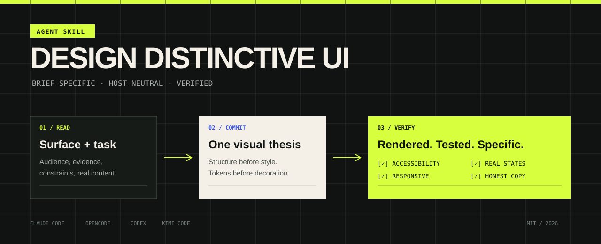
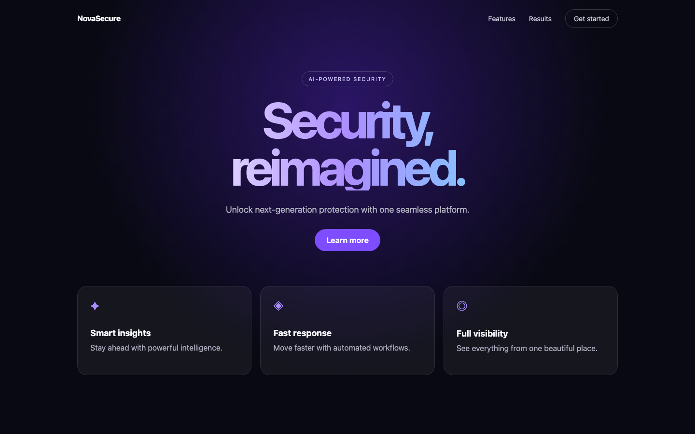
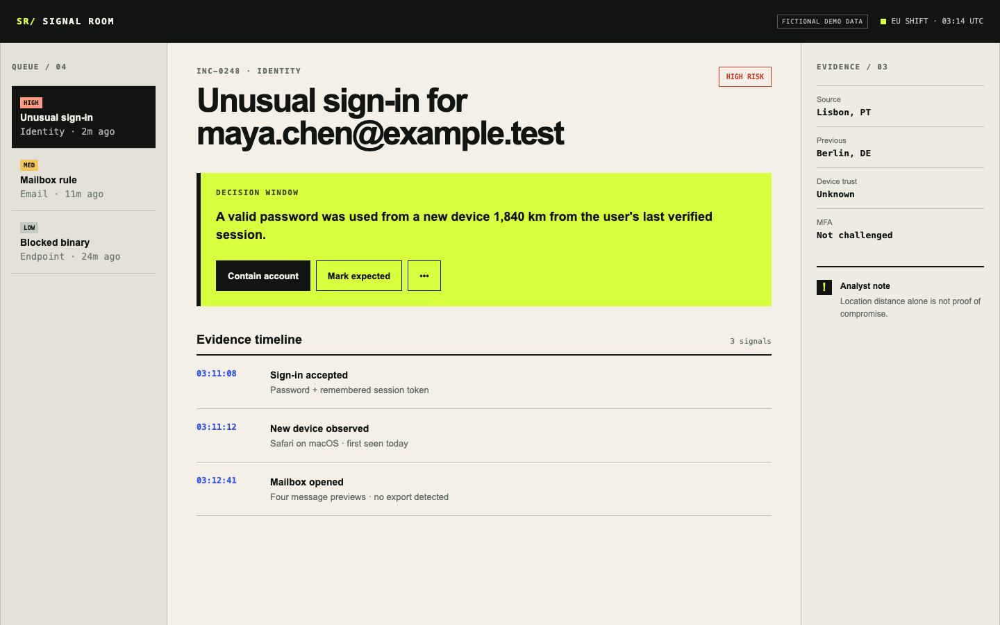

<p align="center">
  
</p>

<p align="center">
  <a href="skill/design-distinctive-ui/SKILL.md"></a>
  <a href="#compatible-agents"></a>
  <a href="LICENSE"></a>
  <a href="#quality-loop"></a>
</p>

<p align="center">
  A portable Agent Skill for designing, building, auditing and polishing web interfaces<br>
  with a brief-specific point of view — without replacing one AI aesthetic with another.
</p>

---

## The problem

AI can produce valid frontend code and still miss the design.

The usual result is recognizable: a centered promise, violet glow, three equal cards,
inflated claims, rounded containers around everything and motion added after the fact.
Removing those ingredients is not enough. A different fixed recipe becomes a different
kind of slop.

**Design Distinctive UI changes the decision process.** It makes the agent read the
product, audience, task, evidence and constraints before it chooses a visual language.

```text
┌─────────────────────────────────────────────────────────────────────────────┐
│  BRIEF  →  DESIGN READ  →  VISUAL THESIS  →  SYSTEM  →  BUILD  →  VERIFY  │
│              │                  │                │                   │       │
│              ├─ audience        ├─ material      ├─ type             ├─ a11y│
│              ├─ primary job     ├─ rhythm        ├─ color            ├─states│
│              └─ constraints     └─ energy        └─ motion           └─viewports
└─────────────────────────────────────────────────────────────────────────────┘
```

## Before → after

The examples use the same fictional brief:

> A security analyst needs to triage a suspicious sign-in in under a minute.

They make no product or performance claims. The “before” is intentionally generic; the
“after” starts with the working task and evidence.

<table>
  <tr>
    <th width="50%">Before — category-shaped</th>
    <th width="50%">After — task-shaped</th>
  </tr>
  <tr>
    <td></td>
    <td></td>
  </tr>
  <tr>
    <td>
      Generic promise · decorative glow · equal cards · vague CTA · no clear analyst task
    </td>
    <td>
      Incident first · evidence hierarchy · explicit next action · operational states · restrained signal color
    </td>
  </tr>
</table>

[Inspect the before source](examples/before/index.html) ·
[Inspect the after source](examples/after/index.html)

## What the skill can do

| Mode | What it changes |
| --- | --- |
| **Build** | Turns a brief into a visual thesis, design contract and verified implementation. |
| **Component** | Designs one component with every state its behavior can actually enter. |
| **Audit** | Reports evidence-backed visual, UX, accessibility and anti-slop findings without editing. |
| **Redesign** | Changes visual structure while preserving routes, behavior, content boundaries and hooks. |
| **Study** | Extracts transferable design DNA from a reference without pixel-cloning it. |
| **Polish** | Makes a few decisive improvements, then verifies the rendered result. |

### It reasons before it decorates

- Compresses the brief into `surface · audience · primary job · tone · constraints`.
- Sets contextual **variance**, **motion** and **density** dials.
- Commits to one visual thesis and one structural fingerprint.
- Orders marketing content by uncertainty and product UI by the working task.
- Rejects invented metrics, testimonials, customers, awards and capabilities.

### It protects production behavior

- Inspects repository instructions, stack, tokens and real verification commands first.
- Preserves routes, analytics hooks, field names, component ownership and working behavior.
- Uses the existing package manager and project-native patterns.
- Treats loading, empty, error and success as behavioral states, not decorative checkboxes.

### It verifies the result

- Targets semantic HTML, keyboard operation and WCAG 2.2 AA.
- Checks focus, contrast, reduced motion, reflow and touch targets.
- Requires rendered inspection at relevant mobile and desktop widths.
- Includes a deterministic static heuristic for common quality risks.

## Quality loop

```text
code checks
    │
    ▼
static heuristic ──▶ rendered inspection ──▶ keyboard + states
    ▲                                            │
    └──────────── fix the evidence ◀─────────────┘
                         │
                         ▼
             purpose · hierarchy · specificity
             coherence · restraint · robustness
```

Run the bundled heuristic from the skill directory:

```bash
python3 scripts/ui_quality_lint.py \
  --html path/to/page.html \
  --css path/to/styles.css \
  --format text
```

It flags review prompts such as missing labels, removed focus outlines, placeholder links,
`transition: all`, risky viewport units and suspicious template combinations. It is a
heuristic — not a substitute for browser inspection or a WCAG conformance audit.

## Install

Clone once:

```bash
git clone --depth 1 https://github.com/bugroo/design-distinctive-ui.git \
  ~/.local/share/design-distinctive-ui
```

### Codex · OpenCode · Kimi Code

These agents discover the shared `.agents/skills` location:

```bash
mkdir -p ~/.agents/skills
ln -s ~/.local/share/design-distinctive-ui/skill/design-distinctive-ui \
  ~/.agents/skills/design-distinctive-ui
```

### Claude Code

Claude Code discovers `.claude/skills`:

```bash
mkdir -p ~/.claude/skills
ln -s ~/.local/share/design-distinctive-ui/skill/design-distinctive-ui \
  ~/.claude/skills/design-distinctive-ui
```

To update later:

```bash
git -C ~/.local/share/design-distinctive-ui pull --ff-only
```

## Compatible agents

The canonical skill uses only the common `name` and `description` frontmatter fields,
relative resource links and host-neutral capability language.

| Agent | Discovery path | Explicit invocation |
| --- | --- | --- |
| **Codex** | `~/.agents/skills` | `$design-distinctive-ui` |
| **Claude Code** | `~/.claude/skills` | `/design-distinctive-ui` |
| **OpenCode** | `~/.agents/skills` | Ask the agent to load `design-distinctive-ui` |
| **Kimi Code** | `~/.agents/skills` | `/skill:design-distinctive-ui` |

`agents/openai.yaml` contains optional Codex presentation metadata. Other hosts can ignore it.
See the full [platform compatibility reference](skill/design-distinctive-ui/references/platform-compatibility.md).

## Example prompts

```text
Use design-distinctive-ui to redesign this landing page.
Preserve routes, copy facts and analytics hooks. Remove the generic AI feel.
```

```text
Audit this dashboard in read-only mode. Rank findings by user impact and
separate objective failures from matters of taste.
```

```text
Study this reference image, extract its transferable design DNA, then create
a distinct implementation for our product. Do not pixel-clone it.
```

```text
Build the empty, loading, error, success and keyboard states for this search
component using the existing design system.
```

## Repository map

```text
.
├── README.md
├── assets/                         # README visuals
├── examples/
│   ├── before/                     # intentional anti-example
│   └── after/                      # task-first redesign
└── skill/
    └── design-distinctive-ui/
        ├── SKILL.md                # portable core
        ├── agents/openai.yaml      # optional Codex metadata
        ├── references/             # progressive design guidance
        └── scripts/                # linter + portability validator
```

Validate the package:

```bash
python3 skill/design-distinctive-ui/scripts/validate_portability.py \
  skill/design-distinctive-ui
```

## Philosophy

```text
ANTI-SLOP ≠ ban gradients
ANTI-SLOP ≠ always use serif
ANTI-SLOP ≠ make everything brutalist

ANTI-SLOP = every visible decision has a reason in this brief
```

The skill treats originality as the product of specificity, hierarchy, proportion,
language and verification — not novelty theatre.

## Acknowledgements

This is an original synthesis informed by
[Hallmark](https://github.com/Nutlope/hallmark),
`design-taste-frontend`, `frontend-skill`, `frontend-design`,
`impeccable-design-polish` and `design-auditor`.

Hallmark is licensed under MIT. This project is not a fork and does not claim affiliation
with its maintainers. See [NOTICE](NOTICE) for attribution details.

## License

[MIT](LICENSE)
